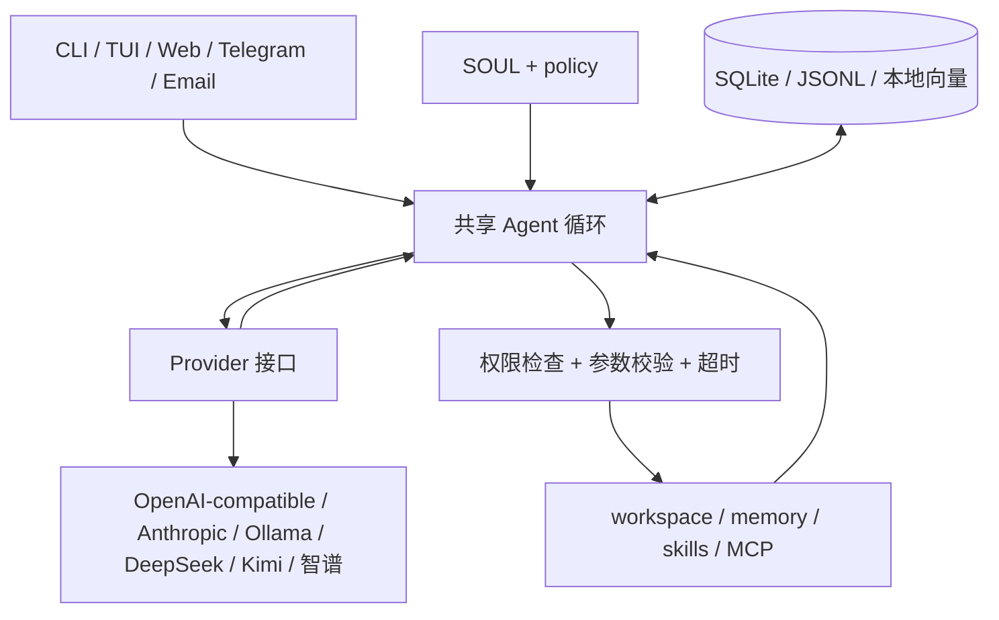

# joyagent · 自己的六层 Agent

一个可以直接运行、逐层替换的个人 Agent 项目。Python 3.11+，Agent 内核只使用标准库，支持 macOS / Linux。可选的终端 TUI 使用 Node.js 22.19+。

默认先通过千问决策模型判断任务复杂度：只有判为复杂且该类别概率至少为 `0.8` 时使用 IdeaLab `qwen3.8-max`，简单、不确定或分类失败都使用 `qwen3.8-flash`。同一套 Agent 循环可以从 CLI、TUI、Web、Telegram 和 Email 使用。聊天优先读取 `IDEALAB_API_TOKEN`，自动分类及独立决策工具优先读取千问AI平台的 `QWENCLOUD_API_KEY`；未设置时分别读取各自配置的私有凭据文件。Web 可以手动选择模型，也可在管理员启用后切换 JoyAgent、Codex、pi 和 DeepSeek Harness，见 [Agent 安装与切换](docs/agent-backends.md)。仓库不包含真实密钥；其他机器需配置自己的密钥或部署私有凭据文件。离线演示需使用 Demo 并关闭自动路由和决策工具，无需 API Key。

## 先运行

仓库已包含默认配置，准备好凭据后在项目目录执行：

```bash
python3 -m joyagent doctor
python3 -m joyagent chat -m '现在几点'
python3 -m joyagent chat -m '记住：我喜欢中文回答'
python3 -m joyagent chat -m '搜索记忆 中文'
python3 -m joyagent web
```

Web 打开 [http://127.0.0.1:8765](http://127.0.0.1:8765)。终端持续聊天用 `python3 -m joyagent chat`，`/exit` 退出，`/session project-name` 切换会话；通道会话名使用英文字母、数字、点、冒号、下划线或连字符。

需要让团队通过浏览器使用时，采用免登录、按浏览器隔离数据的共享模式，不需要用户名、密码或邀请码，见[共享 Web 部署说明](docs/deploy-shared-web.md)。仓库默认仍为本机模式。

需要离线演示时，把 `agent.toml` 的整个 `[model]` 段替换为以下内容，并将已有 `[routing]`、`[decision]` 两段中的 `enabled` 都改为 `false`：

```toml
[model]
provider = "demo"
model = "demo"
```

Demo 支持：

```bash
python3 -m joyagent chat -m '写入文件 hello.md：你好，这是我的 Agent。'
python3 -m joyagent chat -m '读取文件 hello.md'
python3 -m joyagent chat -m '列出文件'
python3 -m joyagent chat -m '忘记记忆 preference'
```

文件实际写入 `workspace/hello.md`。Demo 是确定性的离线工具演示，只识别这些命令，不是语言模型；`记住：...` 使用同一个 `preference` 键，后一次会更新前一次。真实模型可以自己选择记忆键、理解自由表达和规划多步任务。

也可以安装为命令：

```bash
python3 -m venv .venv
source .venv/bin/activate
python -m pip install -e .
joyagent chat
```

给另一个独立 Agent 创建配置：

```bash
joyagent init ~/my-agent
joyagent --config ~/my-agent/agent.toml chat
```

`init` 不覆盖已有文件。所有相对路径均相对于 `agent.toml`，不受启动目录影响。

项目已更名为 `joyagent`。如果之前安装过项目，请重新执行 `python -m pip install -e .` 更新命令入口。已有 `data/`、`workspace/` 和会话历史可继续使用，浏览器会自动迁移保存的会话选择。

## 终端界面（pi-tui）

TUI 基于 [`@earendil-works/pi-tui`](https://github.com/earendil-works/pi-mono/tree/main/packages/tui)，使用多行编辑器、Markdown 渲染和差量刷新。先安装 Node.js 22.19 或更新版本，再执行：

```bash
# 首次安装锁定版本的界面依赖，需要 npm 和网络；安装后退出。
python3 -m joyagent tui --install

# 在交互终端启动。默认按 agent.toml 自动路由，仍可使用离线 Demo。
python3 -m joyagent tui
python3 -m joyagent tui --config ~/my-agent/agent.toml --session my-project
```

安装为命令后可直接用 `joyagent tui`。普通启动不联网安装依赖；未启用外部 Agent 时，CLI、Web、Telegram、Email 均不依赖 Node.js。TUI 依赖保存在 Python 包的 `tui/node_modules` 中，安装位置需要可写；推荐使用自己的虚拟环境或源码目录。

| 操作 | 用途 |
| --- | --- |
| Enter | 发送消息 |
| Shift+Enter | 换行（需要终端支持；也可粘贴多行文本） |
| Ctrl+C | 运行中取消本轮；空闲时退出 |
| `/session NAME` | 恢复指定会话，与普通 `chat --session NAME` 共用历史 |
| `/new` | 创建新的会话 |
| `/clear` | 清空当前显示，保留数据库和审计历史 |
| `/help`、`/exit` | 帮助、退出 |

界面展示模型、会话名、处理状态，以及每轮完成后的工具名称、成功状态和耗时。当前模型适配器返回整轮结果，尚未逐 token 流式输出。取消会停止 Agent 等待；已执行的文件操作或外部工具操作不会回滚。

TUI 用本地 stdin/stdout JSONL 连接独立 Python 进程，不启动额外 HTTP 服务。所有请求仍进入 `Agent.chat`，沿用 SOUL、policy、模型配置和 SQLite 记忆；思考协议字段不会显示在会话记录里。同一个会话不要同时从多个通道进程发送消息。

## 六层如何落地

| 层 | 实现 | 可以替换的部分 |
| --- | --- | --- |
| L6 通道 | `cli.py`、`channels/`、`static/`、`tui/` | CLI、pi-tui 终端界面、浏览器聊天、Telegram 私聊、IMAP/SMTP |
| L5 人格 | `SOUL.md`、`policy.toml`、`policy.py` | 表达习惯、固定行为规则、程序强制的权限和预算 |
| L4 记忆 | `memory.py` | SQLite 会话/偏好、JSONL 审计、词法与哈希向量混合检索 |
| L3 工具 | `tools.py`、`skills.py`、`mcp.py` | 内置工具、可读 SKILL.md、外部 MCP stdio server |
| L2 循环 | `agent.py` | 观察上下文 → 请求模型 → 执行工具 → 再观察，直到回复或达到预算 |
| L1 模型 | `providers.py`、`types.py` | Demo、OpenAI-compatible、Anthropic、Ollama、DeepSeek、Kimi、智谱 |



消息和工具调用使用中立的数据结构，不存储厂商 SDK 对象。更换模型后，历史、人格、记忆和工具接口继续沿用。统一注入人格能提高一致性，但不能保证不同模型的表达和判断完全相同；工具权限由代码检查，不依赖模型是否听话。

## 连接真实模型

编辑 `agent.toml` 的 `[model]`。`model` 填服务实际提供、支持工具调用的模型 ID。Key 优先从 `api_key_env` 指定的环境变量读取；未设置或仅为空白时，再读取 `credentials_file` 中匹配的本机默认凭据。项目不会自动加载 `.env`。

默认聊天的凭据文件为 `~/.config/joyagent/idealab-credentials.toml`。文件位于仓库之外，格式如下（这里只展示占位符）：

```toml
[openai]
base_url = "https://idealab.alibaba-inc.com/api/openai/v1"
api_key = "替换为 IdeaLab 聊天密钥"
```

目录权限设为 `700`，文件设为 `600`。只接受当前用户拥有的普通文件；凭据文件不能是符号链接。默认凭据同时绑定 provider 和 API 地址，改为其他服务或代理地址时不会沿用。`doctor` 只报告凭据来源，不打印密钥；内置文件工具不能读写配置的凭据文件。

自己的密钥可以直接覆盖默认值：

```bash
export IDEALAB_API_TOKEN='你自己的 IdeaLab API Key'
export QWENCLOUD_API_KEY='独立决策工具使用的千问AI平台 API Key'
python3 -m joyagent tui
```

默认凭据缺失时会明确报错。自有密钥若被服务端拒绝，不会自动改用另一把密钥重试。仅使用环境变量时可删除 `[model]` 中的 `credentials_file`。

默认聊天使用 OpenAI 兼容适配器连接 IdeaLab，配置如下：

```toml
[model]
provider = "openai"
model = "qwen3.8-flash"
choices = ["qwen3.8-flash", "qwen3.8-max", "bailian/glm-5.2"]
base_url = "https://idealab.alibaba-inc.com/api/openai/v1"
api_key_env = "IDEALAB_API_TOKEN"
token_parameter = "max_tokens"
max_tokens = 16384
timeout_seconds = 120
credentials_file = "~/.config/joyagent/idealab-credentials.toml"
```

关闭自动路由时，`model` 是各通道的默认模型。Web 的手动模型下拉选项来自 `choices`；启用自动路由后的首次加载会切换为“自动选择”，包括从旧页面保存的模型选择迁移，之后继续记住用户手选。发送消息时使用当前设置。最多配置 32 个不同的模型 ID，列表必须包含默认模型；省略 `choices` 时只有默认模型可供手选。切换保留当前会话、记忆和文件，每轮的模型固定，多步工具调用中不会改变；不同浏览器或并发会话的选择互不影响。

所有聊天选项共用这一段的 provider、网关、凭据和参数；这里只填该 Token 已获授权、支持聊天及工具调用的模型，不填 embedding 或搜索服务。客户端不能通过请求修改网关或密钥，服务端也会拒绝未列入 `choices` 的手动模型。管理员修改配置后重启 Web；被移除的旧浏览器选择会回到当前默认设置。

### 自动选择 Flash 或 Max

默认配置启用以下路由，两个聊天目标都使用 `[model]` 的 IdeaLab 网关和凭据：

```toml
[routing]
enabled = true
simple_model = "qwen3.8-flash"
complex_model = "qwen3.8-max"
min_probability = 0.8
```

普通聊天每轮最多调用一次千问 `decision-model-preview`，分类输入仅包含当前问题和最近少量用户、助手对话，不包含私有模型协议字段或服务凭据。`min_probability` 是两类统一的确定性阈值：只有分类为 `complex` 且该类别概率至少为 `0.8` 时使用 Max；简单任务或分类概率不足都使用 Flash。分类出错或超时时也使用 Flash，不自动重试，并在 Web 结果和历史中显示回退原因。

旧配置的 `simple_min_probability` 仍可读取，按新的两类统一阈值处理；迁移时将字段改名为 `min_probability`。两个字段不能同时出现，否则启动报错。

Web 手动选择实际模型会跳过自动分类；`/tool`、`/tools` 同样跳过。CLI、TUI、Web、Telegram、Email 都通过同一 `Agent.chat` 和会话锁执行；一轮多步工具调用固定使用本轮选定的聊天模型。

自动分类会使用千问模型额度，后续聊天使用 IdeaLab 额度。分类受 `[decision].timeout_seconds` 的独立时限约束，默认 15 秒，也计入整轮时限；这一次路由判断不占聊天模型调用次数或工具调用次数。显式或由聊天模型调用 `decision_evaluate` 时，仍按普通工具计入预算。启用路由要求 `[decision].enabled = true`、policy 允许 `decision_evaluate`，且两个目标位于 `model.choices` 中；配置不满足时启动报错。`doctor` 仅校验配置与本地凭据并显示两个目标，不访问模型服务。

关闭 `[routing]` 即恢复固定默认模型；要离线运行还需切换 Demo 并关闭 `[decision]`。修改路由后重启通道。

2026-10-24 已通过正式服务的沙箱内部 HTTP 验证两条真实路由：简单问候使用 Flash，mutex/CAS/ABA 分析使用 Max，结果及路由信息均已保存到会话历史。此验证经 JoyAgent 内核完成，尚不能代表真实浏览器端到端或全部外部 CLI 的真实模型验收，详见[验证记录](docs/verification.md)。

### 其他聊天网关与直连接口

上述适配器请求 `/chat/completions`，协议说明见 [IdeaLab Chat Completion 文档](https://alidocs.dingtalk.com/i/nodes/NZQYprEoWoxKPoqwCKe4wlvnV1waOeDk)。`api_key_env` 填环境变量名称，不能把其他客户端的 `{env:IDEALAB_API_TOKEN}` 文本直接写成密钥。切换到此适配器时需删除 DeepSeek 专用的 `thinking` 配置。

DeepSeek Flash 的协议兼容已就绪，IdeaLab 的准确 ID 是 `bailian/deepseek-v4.1-flash-1017`，见 [IdeaLab 模型详情](https://idealab.alibaba-inc.com/#/open/model/detail/deepseek-v4.1-flash?name=bailian%2Fdeepseek-v4.1-flash-1017)。2026-10-24 真实请求返回 HTTP 403“该模型需要授权”，当前 IdeaLab Key 尚无权限，因此默认未启用，聊天和工具循环验收未通过。管理员为该 Key 开通权限后，可将此 ID 加入 `[model].choices` 并重启，再执行真实调用验收；模型页面或模型列表不能证明密钥已有权限。此 ID 与 DeepSeek 官方直连服务的模型名称不同，不通过尝试别名绕过授权。

千问AI平台也可用于聊天。切换前备份配置，再将现有 `[model]` 中以下字段改为千问网关，其他字段沿用上例，并重启服务。凭据文件中的 `[openai].base_url` 也须与千问地址一致；`[decision]` 保持独立配置：

```toml
choices = ["qwen3.8-flash", "qwen3.8-max", "glm-5.2"]
base_url = "https://maas.qianwenaiapi.com/compatible-mode/v1"
api_key_env = "QWENCLOUD_API_KEY"
credentials_file = "~/.config/joyagent/qianwen-credentials.toml"
```

聊天模型列表中的 ID 必须以当前网关为准，例如 IdeaLab 使用 `bailian/glm-5.2`，千问AI平台使用 `glm-5.2`；不要直接跨网关复制整个 `choices`。`[model]` 一次只使用一个聊天网关，Web 的模型选择不会切换网关。路由的两个目标也必须在新网关可用，否则先关闭 `[routing]`。千问协议见 [OpenAI 兼容文档](https://platform.qianwenai.com/docs/api-reference/toolkitframework/openai-compatible/overview)。

DeepSeek、Kimi、智谱有独立的 provider 名称，内置下列标准 API 配置，不必手动填写 `base_url` 和 `api_key_env`：

| provider | 默认 API 地址 | 默认密钥环境变量 | 模型 ID 示例 |
| --- | --- | --- | --- |
| `deepseek` | `https://api.deepseek.com` | `DEEPSEEK_API_KEY` | `deepseek-flash` |
| `kimi` | `https://api.moonshot.cn/v1` | `MOONSHOT_API_KEY` | `kimi-k2.6` |
| `zhipu` | `https://open.bigmodel.cn/api/paas/v4` | `ZHIPU_API_KEY` | `glm-4.7` |

这些模型 ID 来自官方文档，实际可用性以你的账号为准；适配器不硬编码可用模型，Web 使用管理员配置的 `choices` 限定可选项。三家的请求默认使用 `max_tokens`，可以用 `base_url` / `api_key_env` 覆盖标准地址和密钥变量名。智谱这里使用标准 API 密钥，Coding Plan 的密钥与适用工具不同。[DeepSeek 文档](https://api-docs.deepseek.com/)、[Kimi 模型文档](https://platform.kimi.com/docs/api/models-overview)、[智谱接口文档](https://docs.bigmodel.cn/api-reference/模型-api/对话补全)。

以下直连示例需先将 `[routing].enabled` 设为 `false`；独立 `[decision]` 可继续使用千问凭据，或按需关闭。例如接入 DeepSeek，将现有 `[model]` 段替换成：

```toml
[model]
provider = "deepseek"
model = "deepseek-flash"
max_tokens = 16384
timeout_seconds = 120
credentials_file = "~/.config/joyagent/credentials.toml"
# 可选：thinking = "enabled" 或 "disabled"
```

```bash
export DEEPSEEK_API_KEY='你的标准 API 密钥'
python3 -m joyagent doctor
python3 -m joyagent chat
```

Kimi 对应配置：

```toml
[model]
provider = "kimi"
model = "kimi-k2.6"
max_tokens = 16384
timeout_seconds = 120
```

```bash
export MOONSHOT_API_KEY='你的 API 密钥'
```

智谱对应配置：

```toml
[model]
provider = "zhipu"
model = "glm-4.7"
max_tokens = 16384
timeout_seconds = 120
```

```bash
export ZHIPU_API_KEY='你的标准 API 密钥'
```

换配置后重新运行 CLI/TUI 或重启 Web 服务。`doctor` 会检查密钥来源和本机凭据文件权限，但不会联网验证密钥。

三家都支持多步工具调用所需的 `reasoning_content` 保存与回传，只有 provider、模型 ID、API 地址全部一致时才会重放；不会把这类协议状态发给另一个模型。它会进入 SQLite/JSONL 并占用上下文预算，但不会作为聊天正文或 Web 历史 API 的字段返回。已有历史记录无需迁移。旧会话如果缺少目标模型要求的思考字段，切换模型后建议使用新会话，避免接口拒绝不完整历史。[DeepSeek 思考模式](https://api-docs.deepseek.com/guides/thinking_mode/)、[Kimi 思考模型](https://platform.kimi.com/docs/guide/use-thinking-models)、[智谱思考模式](https://docs.bigmodel.cn/cn/guide/capabilities/thinking-mode)。

`thinking` 省略时使用模型自身默认行为。它仅适用于 `deepseek` / `kimi` / `zhipu`：Kimi K3 不接受该参数；Kimi K2.7-code 和 GLM-5.3 系列不支持关闭思考。其他模型的能力以官方说明为准。思考过程可能消耗较多 token；长任务可在 `policy.toml` 中把 `turn_timeout_seconds` 调到 `300`、`context_chars` 调到 `200000`，并按实际需要调整。程序仍执行每轮工具和模型调用次数上限。

OpenAI 或 OpenAI-compatible 服务：

```toml
[model]
provider = "openai"
model = "填写模型 ID"
base_url = "https://api.openai.com/v1"
api_key_env = "OPENAI_API_KEY"
timeout_seconds = 60
max_tokens = 2048
# 部分兼容服务使用旧参数，必要时启用：
# token_parameter = "max_tokens"
```

```bash
export OPENAI_API_KEY='你的密钥'
python3 -m joyagent doctor
python3 -m joyagent chat
```

Anthropic 的配置差异：

```toml
[model]
provider = "anthropic"
model = "填写 Claude 模型 ID"
base_url = "https://api.anthropic.com/v1"
api_key_env = "ANTHROPIC_API_KEY"
max_tokens = 2048
```

Ollama 的配置差异：

```toml
[model]
provider = "ollama"
model = "填写本机已下载且支持工具调用的模型名"
base_url = "http://localhost:11434"
timeout_seconds = 120
max_tokens = 2048
```

先自行启动 Ollama 并下载模型。若本地模型推理较慢，同时调整 `policy.toml` 中的 `turn_timeout_seconds`。远程模型地址必须使用 HTTPS，本地回环地址可以使用 HTTP。

当前适配文本和工具调用，不含流式输出、视觉输入或自动重试。自动路由只在一轮开始时选择聊天模型；后续聊天模型出错时会记录失败并停止当前轮，不切换模型重做已执行的操作。

## 人格、权限和持续循环

- `SOUL.md`：每轮读取，修改后下一轮生效，最多 16 KiB。
- `policy.toml`：启动时加载；修改工具权限或预算后重启通道。
- JoyAgent 工具的 `tools.allow` 是白名单，`tools.deny` 优先，支持通配符。未授权的 JoyAgent 工具既不向模型公布，也不能执行。可选外部 CLI 的权限来自管理员显式启用和进程隔离，详见 [Agent 权限边界](docs/agent-backends.md)。
- 默认每轮最多 8 次聊天模型调用、16 次工具调用、120 秒；每个异步工具最多 20 秒。显式或由聊天模型调用的决策工具计入工具次数，另受 `[decision].timeout_seconds` 限制。自动路由另有每轮至多一次的分类请求，不占上述调用次数，但计入整轮时限和千问模型额度。
- 同一进程内，同一会话串行执行；不同会话可并发。每次聊天默认只发送本次输入及同一会话最近两轮历史，旧聊天记录仍可查看，不会发送其他会话的聊天记录。`policy.toml` 的 `[limits].context_turns = 2` 控制此前轮数；`history_messages` 是读取上限提示，`context_chars` 继续限制总大小，必要时减少历史轮数。本轮的补充指令、工具调用与返回完整保留，不占此前两轮的名额。系统规则、工具定义和显式保存的长期偏好继续提供；预算按字符限制，不等于精确 token 计费。
- 中止时保存完整工具消息组；下一轮仍能继续使用合法历史。触发模型/工具预算会返回明确的暂停结果。

这是由消息驱动的持续行动循环，Telegram 和 Email 通道会持续轮询新消息；当前没有自主定时规划、无限后台目标执行或 cron 调度。

默认内置工具：

| 工具 | 用途 |
| --- | --- |
| `time_now` | 配置时区的当前时间 |
| `decision_evaluate` | 调用独立决策模型进行分类、是非判断和评分，会使用模型额度 |
| `workspace_list/read/write` | 独立工作目录里的文件操作，写入默认禁止覆盖 |
| `memory_remember/search/forget` | 显式保存、检索、遗忘当前长期记忆 |
| `skills_list/read` | 列出并阅读本地技能指南 |

`workspace` 中的路径穿越、符号链接、凭据目录和 Agent 自身配置/记忆路径被拒绝。文件操作使用目录描述符和不跟随符号链接的打开方式。默认没有 shell 工具；可按下文显式启用 Linux 隔离执行器。个人模式未设置 `sandbox=true` 的 MCP 仍是普通本地进程，拥有该系统用户的权限。

### 显式执行工具、命令和脚本

Web 的“执行工具”面板列出当前 policy 允许的工具，选择工具、填写参数后执行；页面显示工具结果，命令工具还返回退出码及标准输出/错误，刷新后仍可查看执行记录。使用 JoyAgent 时，自然语言请求由聊天模型决定是否调用这些工具。也可以在 CLI、TUI 或 Web 输入下面的显式指令，统一经过 `Agent.chat` 的权限、参数、超时和历史记录流程，**不请求额外聊天模型**。工具本身若依赖远程模型（如 `decision_evaluate`），仍会发出真实模型请求：

```text
/tools
/tool time_now {}
/tool workspace_write {"path":"hello.txt","content":"你好"}
/tool mcp_demo_echo {"text":"MCP 已连接"}
```

Linux 上安装系统包 `bubblewrap`、`util-linux` 后，将现有 `[execution]` 的 `enabled` 改为 `true`，并在 `policy.toml` 的 `tools.allow` 加入 `"command_run"`、`"script_run"`。服务启动时验证隔离能力，缺少依赖或 namespace 不可用就报错，不会退回宿主机执行；macOS/Windows 暂不支持此执行器。

```text
/tool command_run {"command":"pwd; ls -la"}
/tool script_run {"language":"python","code":"from pathlib import Path\nPath('result.txt').write_text('hello')\nprint('已生成 result.txt')"}
```

每次执行只挂载当前工作区和只读系统运行库，不提供宿主 `/proc`、Agent 凭据或其他访客目录。`execution.network = "none"` 默认断网；管理员可显式改为 `"host"`，让命令、脚本、共享 MCP 及三种外部 Agent 共用外层沙箱的网络，使用其 DNS 和 TLS 根证书。host 模式也能访问外层回环端口，权限范围由外层沙箱的网络策略决定；不自动继承代理变量或私有凭据，外层自身的 DNS 故障仍需单独处理。更改后重启服务，已有常驻进程才会采用新设置。

Python 和 Bash 脚本可读写工作区，结果在后续轮次保留。默认 10 秒、输出 8000 字符，并设置单进程地址空间、单文件大小、进程数量等限制；policy 的工具超时和输出上限仍适用。进程限制不是整个服务的内存、磁盘或费用配额，需由部署平台补充资源管理。详见[共享执行配置](docs/deploy-shared-web.md)。

### 决策分类、是非判断与评分

`decision_evaluate` 使用独立的 `decision-model-preview` 服务，接收业务状态 `state` 和问题表 `questions`，返回决策结果。它不替换聊天模型，也不加入 Web 的 `model.choices`。接口与结果字段见[千问AI平台决策模型 API](https://platform.qianwenai.com/docs/api-reference/decision-model-api)。

| 问题 `type` | 用途 | `criteria` |
| --- | --- | --- |
| `choice` | 从给定选项中分类，返回选项与概率 | 选项名到说明的对象 |
| `noul` | 是非判断，返回“是”的概率 | 可选的 `true` / `false` 说明 |
| `score` | 按有序等级评分 | 从低到高排列的等级说明数组 |

默认配置已启用此工具，并在 `policy.toml` 中授权 `decision_evaluate`：

```toml
[decision]
enabled = true
base_url = "https://maas.qianwenaiapi.com/compatible-mode/v1"
model = "decision-model-preview"
api_key_env = "QWENCLOUD_API_KEY"
credentials_file = "~/.config/joyagent/qianwen-credentials.toml"
timeout_seconds = 15
```

网关、模型、超时和凭据都由 owner 控制；调用参数只传业务状态与问题，访客不能替换地址或密钥。决策工具使用自己的千问凭据，与默认聊天的 IdeaLab 凭据分开；`QWENCLOUD_API_KEY` 优先，未设置时读取 `~/.config/joyagent/qianwen-credentials.toml`：

```toml
[openai]
base_url = "https://maas.qianwenaiapi.com/compatible-mode/v1"
api_key = "替换为千问决策模型密钥"
```

此文件同样要求当前用户拥有、权限为 `600` 且不是符号链接，`[openai].base_url` 必须匹配决策网关。修改配置后重启通道；停用决策工具前需先关闭 `[routing]`，再将 `[decision].enabled` 设为 `false` 或从工具白名单移除名称。

在 Web“执行工具”面板选择 `decision_evaluate` 并填写 JSON，或在 CLI、TUI、Web 输入：

```text
/tool decision_evaluate {"state":"支付失败","questions":{"department":{"type":"choice","instructions":"由哪个团队处理？","criteria":{"billing":"支付退款账单","technical":"软件故障"}}}}
```

该命令会向决策服务发出一次真实模型请求，使用服务端模型额度；显式执行省去了额外聊天模型请求。调用仍经过统一 `Agent.chat`、工具权限和历史记录流程。在 JoyAgent 中通过自然语言让聊天模型选择此工具时，还会产生相应的聊天模型请求。外部 CLI 的原生工具集不自动接入此工具；Web 选中其他 Agent 后，仍可通过“执行工具”面板或 `/tool` 显式使用。

超时或取消会停止等待结果，但不能撤回已经发出的模型请求，服务端仍可能完成请求并计费。

## 长期记忆

首次运行创建：

```text
data/
  memory.sqlite3          # 权威存储：消息、当前长期记忆、审计 outbox
  events.jsonl            # 可读审计镜像，带稳定 event_id
  .events.lock            # 跨进程文件锁
  .events.cursor.json     # 镜像交付游标
  native_sessions/        # 使用外部 Agent 后按需创建的私有临时缓存
```

SQLite 事务同时提交业务数据和审计事件；JSONL 写入失败不会丢掉已经提交的数据，后续写入或启动会恢复镜像。支持多个进程共享 data 目录；同一聊天会话请交给一个运行中的通道进程，避免跨进程对同一会话同时发起模型轮次。

检索结合中文双字词元、英文词元的词法匹配和本地哈希向量相似度，不依赖外部 embedding 服务，也不等价于语义向量数据库。启动时恢复 JSONL 的时间与历史事件量成正比，检索会扫描记忆表，适合个人规模。以后可以在这个模块接入 embedding 和向量数据库。

每轮注入相关记忆和最近的明确偏好，最多 6000 字符。个人模式下，不同会话和入口共享长期记忆、隔离聊天历史，Telegram / Email 白名单应只填自己的账号。共享 Web 模式为每个浏览器匿名身份分别保存会话、长期记忆和工作文件；同一浏览器的不同 Web 会话共享自己的长期记忆。清除 Cookie、换浏览器或匿名会话到期后会获得新身份，旧数据不会自动显示。

`memory_forget` 删除当前检索记录，但旧值仍在历史对话和审计日志里。彻底清空时，先停止所有通道，再备份或移走整个 `data/`。对话、工具结果和记忆默认明文保存在本机，模型请求会携带当前上下文，因此不要把密码或 API Key 当聊天内容发送。

## Skills 和 MCP

添加 `skills/你的技能名/SKILL.md` 即可。目录名只允许字母、数字、下划线和连字符，文件最多 32 KiB。技能是模型可读的指南，不自动执行代码，也不授予工具权限。已附带 `getting-started` 工作笔记技能。

接入项目内的 MCP 示例，在 `agent.toml` 加上：

```toml
[mcp.servers.demo]
enabled = true
command = "python3"
args = ["/你的项目绝对路径/examples/mcp_server.py"]
timeout_seconds = 20
```

在 `policy.toml` 的 `tools.allow` 数组中加入 `"mcp_demo_echo"`，重启，输入 `/tool mcp_demo_echo {"text":"你好"}` 即可验证真实 MCP 调用；也可以让真实模型选择工具。Demo 模型不自动选择 MCP 工具。

简单工具导出为 `mcp_<server>_<tool>`；包含特殊字符或过长的名称会转换并附带稳定哈希，以符合模型工具名限制。权限写导出名称。默认只把必要的系统环境传给 server，额外变量显式配置：

```toml
pass_env = ["HTTPS_PROXY"]
env = { SERVICE_TOKEN = "${MY_SERVICE_TOKEN}" }
```

支持 stdio JSON-RPC、初始化协商、工具列表分页、并发响应关联、工具错误、超时和进程清理；当前协商版本为 `2025-06-18`，兼容 `2025-03-26` / `2024-11-05`。尚未原生实现 HTTP MCP、OAuth、resources、prompts 或 sampling。个人模式可手动安装 `mcp-remote` 来桥接 HTTP 服务，见[本机 Codex MCP 清单与迁移说明](docs/mcp-codex.md)和[配置模板](examples/mcp.codex.toml)。模板默认全部关闭，不包含凭据或登录状态。

## 通道配置

Web 默认为 `web.mode = "local"`，只允许 IPv4 回环地址，使用 Host、Origin 和每次启动随机生成的 CSRF token 校验。团队访问需显式配置 `web.mode = "shared"`、实际 HTTPS origin 和私有 `session_dir`，按[共享 Web 部署说明](docs/deploy-shared-web.md)接入 HTTPS 入口。共享模式打开即用，不提供注册登录，也不保存用户名或密码；签名匿名 Cookie、会话 CSRF 校验及独立运行时隔离各浏览器的数据。共享 MCP 只接受显式 `shared=true`、`sandbox=true` 的 owner 程序，每个访客使用独立进程且不传入凭据。

前端使用原生 HTML/CSS/JS，没有构建步骤，也不依赖 Node.js。所有 Web Agent 请求共用一个常驻 asyncio 事件循环；共享模式按用户隔离运行时。

“运行中的 Agent”面板显示当前访客和工作区的状态、PID、Web 会话总数及每个 Agent 使用过的会话数，并单独列出常驻进程中的原生会话缓存数。展开且页面可见时约每 5 秒刷新，支持手动刷新；读取状态不会启动 Agent 或调用模型。Web 总数包含归档会话且去重，切换过多个 Agent 的会话可同时计入多行。统计口径和 PID 说明见 [运行状态](docs/agent-backends.md#查看运行状态)。

Codex、pi、DeepSeek Harness 在首次收到消息时启动，仅在下拉框选择不会启动。同一访客、同一工作区、每种 Agent 最多一个进程；多个 Web 会话共享该进程，各自保留独立的原生会话 ID 和聊天上下文，同一 Agent 串行处理请求。正常回复后持续保留进程，切回会话时补入缺失的对话和工具结果。Codex thread 和 pi 会话文件保存在服务生成的私有缓存中，不使用个人 Agent 的会话目录。

三个外部 Agent 同样遵守最近两轮的历史窗口。窗口向前移动时，清理并重建该 Web 会话对应的原生会话和模型续接缓存，避免原生会话继续携带更早的聊天；共享进程、工作区与其他会话保留。当前窗口未改变时继续增量续接，本轮工具执行和补充指令不会因用户消息数量增加而丢失。输入历史减少不等于模型总提示只剩这些内容，外部 CLI 的固定系统和工具说明仍会计入输入，实际延迟也受模型服务和缓存命中影响。

默认整个服务事件循环最多保留 8 个进程，通过 `backends.resident_limit` 可设置为 1–32；没有固定闲置过期时间，满额时只回收空闲进程。每个进程最多缓存 64 个原生会话，满额时淘汰最久未使用的原生会话；这不限制 Web 会话总量，也不删除 SQLite 历史。本轮模型仍按手选或自动路由确定，空闲进程不能调用模型。失败、超时或取消会重置该 Agent 的共享进程及缓存；受影响的会话下次使用时从有限的 SQLite 历史重建，容量回收或服务重启后也如此，不自动重试上一轮操作。安装和边界详见 [Agent 安装与切换](docs/agent-backends.md)。

空闲进程异常退出会自动恢复，依次等待 1、5、15 秒，自上次成功对话起最多尝试 3 次。恢复不调用模型或重放命令，下一条消息继续使用保存的会话历史；面板显示恢复状态和安全的故障原因。执行中的失败仍须核实工具结果后再发起下一轮。

Web 顶部提供“对话”“AI 资讯”“源码仓库”和“论文”四个入口。“对话”保留 Agent 和模型选择；切换页面时正在执行的任务、会话和草稿继续保留。“AI 资讯”前 10 条展示 [AIhot 热榜](https://aihot.news/hot)，按原站排名排列；其余由 [AI 工具集日报](https://ai-bot.cn/daily-ai-news/)和 [AI Agent Store 周报](https://aiagentstore.ai/ai-agent-news/this-week)按发布时间倒序补足，总计最多 100 条。页面展示标题、链接域名、日期和热榜排名，不展示来源名称；包括热榜在内的标题均直接链接到对应原文，不经过聚合站阅读页。

“源码仓库”按 Agent Harness、模型推理、Agent 开发框架、AI Infra、训练与微调分类，展示项目简介和官方源码链接。Agent 开发框架仅收录 OpenAI Agents SDK、Claude Agent SDK、LangChain、LangGraph。Claude、Kimi、智谱的仓库按用途合并到这些分类：Agent 项目归入 Agent Harness，模型部署资源归入模型推理，其余 SDK 归入 AI Infra。Agent Harness 中先展示 OpenAI Codex、DeepSeek Harness，再展示 Kimi、智谱、Claude 的相关项目。可通过类别导航定位，项目在新窗口打开；切换页签保留正在执行的对话。目录随项目发布维护，不新增定时抓取。

示例配置启用 `[news] enabled = true`，`interval_seconds = 7200`，由 Web 服务每两小时统一抓取一次；没有配置 `[news]` 的旧服务默认关闭，需要管理员启用并重启 Web。首次启动或升级新增来源时立即抓取，其他重启沿用持久化的下次抓取时间。关闭浏览器不影响抓取，停止 Web 服务会停止定时任务。资讯缓存保存在 `agent.data_dir/news.sqlite3`，普通资讯与历史缓存合并后按日期倒序保留；当天不足时用前一天、更早日期补足，不按天或来源分配固定份额。例如热榜占 10 条时，普通资讯今天有 80 条，就再保留昨天最新 10 条。热榜成功更新后替换旧榜，榜单不足 10 条时其余位置仍由普通资讯补足。按阅读链接和已知原文链接去重，超出的旧资讯从数据库删除；日期不完整时只推断内部排序，不伪造发布日期，无日期条目沿用首次发现时间。所有访客共享公开资讯，不调用聊天或决策模型。AIhot 使用官方匿名只读 JSON 接口，并在进程内使用 ETag 条件请求。某来源失败时保留其上次结果并显示状态，页面刷新只读取缓存，不触发额外抓取。

“论文”提供 14 个研究方向的 Hugging Face 社区合集入口，显示方向、合集名称和整理者。默认显示前 4 个合集，其余 10 个可点击展开，再次点击可收起。仅 **Agents 智能体**在本页展示 20 篇论文：优先使用 [Tempo14 的 agents 合集](https://huggingface.co/collections/Tempo14/agents)；合集超过 20 篇时按发表日期选取最近 20 篇，不足时从 Hugging Face Papers 最近 100 篇中按收录时间补选标题含独立单词 `agent`、`agents` 或 `agentic` 的论文，去重补足 20 篇。合集和补选来源分别标明，不调用模型分类。其余 13 类只提供外部链接，不抓取或展示其论文。论文标题直达 arXiv，另有 PDF、HF 讨论和完整摘要；页面日期为 `paper.publishedAt` 发表日期。

示例配置启用 `[papers] enabled = true`、`interval_seconds = 7200`；旧配置未添加该节时默认关闭。服务只使用固定的 HF 合集 API、Daily Papers API 和所选论文 ID 的详情 API，无需 HF Token 或第三方 Python 包，不调用 LLM API、不下载 PDF。每个 Web 服务有独立的 `agent.data_dir/papers.sqlite3` 缓存，首次启动或从通用论文列表升级时立即获取，其后每两小时更新。每次成功后替换这 20 篇，不混入旧列表；来源异常或不足 20 篇时保留上次完整结果。页面刷新只读取缓存，切换页签或关闭浏览器不影响服务端任务，浏览器隐藏论文页时停止列表轮询。

管理员可另行安装离线英译中运行库并配置 `[papers] translation_runtime`（见[共享 Web 部署](docs/deploy-shared-web.md)）。启用后**仅摘要显示中文，标题保持原文**，并提供“查看英文原文”。这是本地 CPU 神经机器翻译，不是 LLM API；专业术语可能存在误译，页面标注“机器翻译”。翻译进程禁用网络、使用独立虚拟环境，不继承模型凭据，也不接触访客工作区。首次启用为缓存的论文补齐中文摘要，每篇完成即写入 SQLite；以后只翻译新增、摘要变更或翻译引擎变更的内容，重启复用结果。缓存随当前 20 篇精选论文裁剪，翻译失败保留已完成结果和英文原文，下次计划执行再试。普通启动不会自动安装或下载翻译依赖。

Web 侧栏提供“新建会话”、活动会话列表和“已归档”列表。新会话从空白聊天开始，未手动命名时发送第一条消息后自动生成简短标题；旧版 `default` 和其他已有 Web 会话会自动进入列表，刷新页面后仍可继续。列表、名称和归档状态存储在服务端 SQLite 中，不依赖浏览器本地存储保存聊天记录。

在会话下方点击“重命名”，输入 1–80 个字符的单行名称即可保存，支持中文。活动、归档和正在执行的会话都可以改名；会话 ID、消息、草稿和 Agent 执行状态保持不变，后续聊天不会覆盖手动名称。取消或名称校验失败不会提交修改。

一个会话处理时，仍可新建或切换其他会话并发送消息。回复、错误和草稿跟随各自会话，后台完成不会跳走当前页面；列表提示处理状态。正在处理的会话暂不能启动重复任务、归档或删除，其他会话可继续操作。共享 Web 默认每访客最多 4 个在途请求、全局最多 8 个；同一种外部 Agent 共用进程并依次处理，排队时间计入整轮超时，不会为每个会话另起进程。

网页发送一次聊天请求后，保持等待直到本轮返回，不轮询结果、不额外设置 10 秒的聊天请求超时，也不自动重发。Agent 原有的整轮超时与工具预算仍生效。入口返回 HTML 或其他无效响应时，页面显示 HTTP 状态及可理解的提示，不再直接显示 JSON 解析异常；无法确认执行结果时，请重新打开该会话核对历史。刷新页面不会自动重发任务。

执行期间可以继续在输入框写要求，点击“补充指令”引导当前任务，例如“先只分析，不修改文件”或“改为输出中文，并优先检查测试失败”。JoyAgent 在下一安全步骤采用补充要求；Codex、pi、DeepSeek Harness 以及显式工具执行会先完成当前轮，再自动续接。不会打断正在执行的命令，也不撤销已执行的操作。补充要求沿用本轮 Agent、模型及剩余预算，不重新分类或重置超时；每轮最多接受 8 条，总字符数不超过 policy 的单条输入上限。页面区分待应用、已应用和未应用；失败、取消或预算耗尽时不会自动重试剩余要求，文本仍保留供核实后继续。补充输入不是另一次 `/tool` 直接执行。

会话列表和聊天标题下方显示固定的会话 ID。标题下方显示完整 ID，可选中复制，并用侧栏“按会话编号打开”恢复同一访客下的会话。新建会话生成新的 `chat-…` ID；刷新、归档、恢复及切换 Agent 保持 ID，旧会话继续使用原编号。这里显示的是 Web 会话 ID，各 Agent 的原生会话 ID 由服务内部管理。

归档只把会话移入“已归档”，保留消息、工具结果、审计历史及原生 Agent 会话；进程和原生会话缓存仍受容量回收规则约束。归档会话可以查看，恢复后可继续发送消息；正在执行的会话要等本轮结束后再归档。新建和切换会话隔离聊天上下文，同一浏览器身份下的长期记忆与工作区仍然共享。每个会话记住自己的 Agent 选择，模型选择和自动路由规则继续生效。

活动和归档会话均可点击“删除”，确认后先卸载并清理各 Agent 中对应的原生会话，再永久清除消息、工具记录、标题及对应的 SQLite/JSONL 审计记录，不能恢复。正常删除保留共享进程与其他会话；原生清理异常时会重置该 Agent 的缓存，其他会话下次使用时重建上下文。清理期间不能继续发送、归档或重复删除；清理未完成会提示重试。仅保留会话编号和删除时间，阻止旧标签页继续写入或重新创建该编号；执行中的会话需等本轮结束后再删除。删除当前会话后切换到其他活动会话，没有其他会话时新建空白会话。同一浏览器身份共享的长期记忆和工作区文件不随会话删除；已有备份及模型服务商记录也不在此功能的清理范围内。收起列表后，“会话列表”入口仍保留，点击即可重新展开。

Telegram：

```toml
[telegram]
token_env = "TELEGRAM_BOT_TOKEN"
allowed_user_ids = [123456789]  # 换成自己的数值用户 ID
poll_timeout = 20
```

```bash
export TELEGRAM_BOT_TOKEN='你的 Bot Token'
python3 -m joyagent telegram
```

仅接收白名单用户的私聊，不处理群聊；轮询偏移保存在 data 中。不要同时启动两个使用同一个 Bot 的 Telegram 通道。

Email 使用 IMAP 读取与 SMTP 回复，默认关闭：

```toml
[email]
enabled = true
imap_host = "imap.example.com"
imap_port = 993
smtp_host = "smtp.example.com"
smtp_port = 465
smtp_security = "ssl"       # 或 starttls，常见端口 587
user_env = "AGENT_EMAIL_USER"
password_env = "AGENT_EMAIL_PASSWORD"
auth_token_env = "AGENT_EMAIL_TOKEN"
allowed_senders = ["me@example.com"]
poll_interval = 30
mailbox = "INBOX"
initial_backlog = false
```

```bash
export AGENT_EMAIL_USER='agent@example.com'
export AGENT_EMAIL_PASSWORD='邮箱应用密码'
export AGENT_EMAIL_TOKEN='自己生成的一段足够长的随机口令'
python3 -m joyagent email
```

默认首次启动跳过旧邮件，只处理新的纯文本邮件；单封最多 256 KiB，正文最多 12000 字符。只向精确白名单的 From 地址回复，忽略 Reply-To、CC 和模型生成的收件人。过滤自动回复、邮件列表与自身邮件，通过 UIDVALIDITY、UID 和 Message-ID 减少重复。不要同时启动两个使用同一邮箱/数据目录的邮件通道。

请求邮件需包含 `X-JoyAgent-Token: <AGENT_EMAIL_TOKEN 的值>` 自定义邮件头；口令不会作为邮件正文传给模型。From 本身可以伪造，因此默认同时验证口令。只有邮箱入口已由其他机制验证发送者身份时，才考虑显式设 `auth_token_env = ""`。普通邮件客户端若不能添加自定义邮件头，可通过自己控制的发信程序添加该头，或者先使用 CLI、Web、Telegram。

升级前使用的 `X-JYAgent-Token` 仍按相同口令校验规则接受；新旧鉴权头不能同时出现，也不能重复。自动回复统一使用 `X-JoyAgent-AutoReply`，并识别新旧标记以避免回复循环。

Telegram 和 Email 在发送前持久化准备好的回复，发送失败会重试该回复，避免再次执行已完成的 Agent 工具动作。远端接受消息后、确认或本地游标提交前发生故障，仍可能重复投递；Agent 在外部操作完成后立刻崩溃，也无法保证操作只发生一次。涉及不可重复的操作时，扩展工具应提供自身的幂等键。

## 扩展与验证

新增 provider：实现 `types.Provider.complete(messages, tools) -> ModelReply`，在 `create_provider` 注册。新增工具：用 `ToolSpec` 和 handler 注册到 `ToolRegistry`，再配置白名单。新增通道：只负责输入输出、身份校验和会话 ID，调用 `runtime.chat()`，由它统一选择模型并进入 `Agent.chat()`。

```bash
python3 -m unittest discover -s tests -v
# 修改 TUI 后，在安装其依赖的基础上运行：
npm --prefix joyagent/tui test
```

测试覆盖模型协议转换、多步调用、人格注入、权限与路径检查、取消恢复、MCP 子进程、记忆跨进程一致性和崩溃恢复，以及通道输入/身份校验。网络模型使用模拟 HTTP，Telegram/邮件使用模拟传输；Web 测试仅监听本机回环地址，不需要账号、付费 API 或真实收发消息。

协议参考：[OpenAI Chat Completions](https://developers.openai.com/api/reference/resources/chat/subresources/completions/methods/create)、[Anthropic 工具调用](https://platform.claude.com/docs/en/agents-and-tools/tool-use/handle-tool-calls)、[Ollama Chat](https://docs.ollama.com/api/chat)、[MCP 生命周期](https://modelcontextprotocol.io/specification/2025-06-18/basic/lifecycle)、[MCP stdio](https://modelcontextprotocol.io/specification/2025-06-18/basic/transports)。
